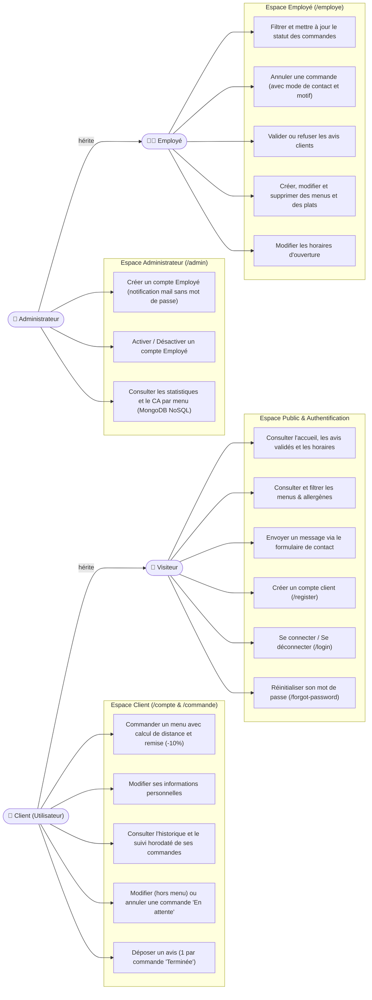
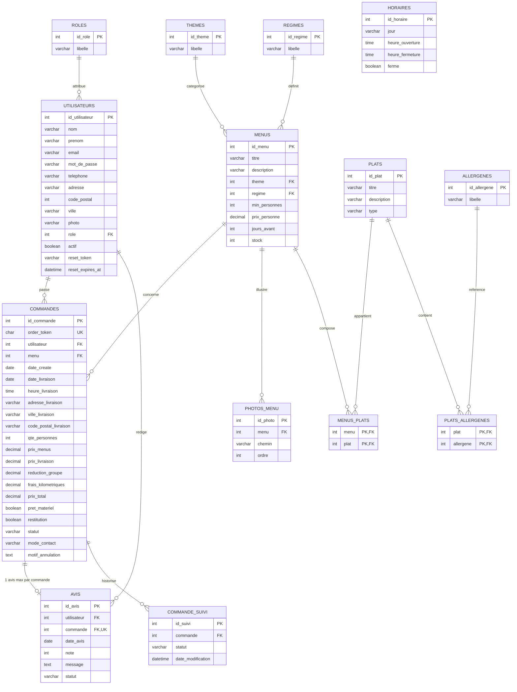
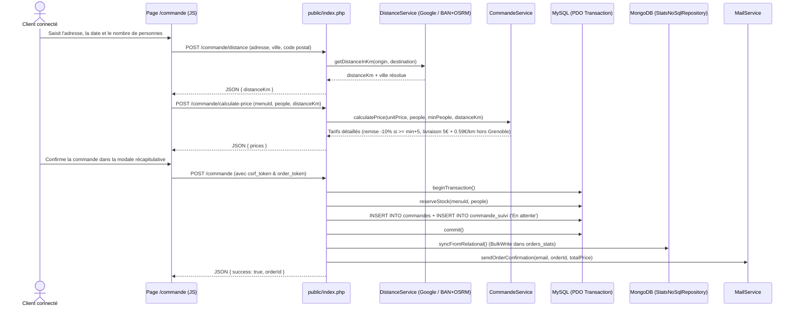
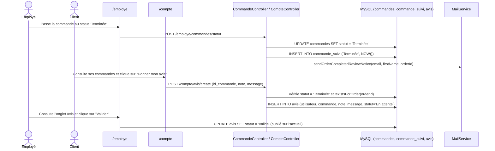

# Diagrammes UML & Modélisation des Données (Merise & NoSQL) — Vite & Gourmand

Ce document regroupe l'ensemble des diagrammes d'architecture et de modélisation à jour de l'application **Vite & Gourmand** (conformes au référentiel DWWM et au cahier des charges ECF) :
1. **Diagramme de Cas d'Utilisation (Use Case Diagram)**
2. **Modèle Conceptuel et Physique de Données Relationnelles (MCD / MLD / MPD — MySQL 8.0)**
3. **Schéma Documentaire NoSQL (MongoDB 7.0 — Statistiques Administrateur)**
4. **Diagramme de Classes UML (Architecture MVC / POO)**
5. **Diagrammes de Séquence UML** (Passation de commande, Suivi & Avis client, Réinitialisation de mot de passe)

---

## 1. Diagramme de Cas d'Utilisation (Use Case)

Conformément au cahier des charges :
- Le **Visiteur** peut consulter l'accueil, les horaires, les avis validés, filtrer/consulter les menus, envoyer un message de contact, créer un compte client (`/register`) ou réinitialiser son mot de passe (`/forgot-password`).
- Le **Client (`Utilisateur`)** hérite du Visiteur et peut passer commande, modifier son profil, suivre ses commandes, modifier/annuler une commande tant qu'elle est **`En attente`**, et déposer un unique avis (note 1 à 5 + commentaire) sur une commande **`Terminée`**.
- L'**Employé** peut gérer les menus, les plats, les horaires d'ouverture, filtrer et faire évoluer le statut des commandes (ou annuler avec motif et mode de contact client) et modérer les avis clients (`Validé` / `Refusé`).
- L'**Administrateur** hérite des droits de l'Employé et peut créer/désactiver des comptes **Employés** (jamais un compte Administrateur) ainsi que consulter les statistiques et le chiffre d'affaires par menu issus de la base **NoSQL MongoDB**.



---

## 2. Modèle de Données Relationnelles (MCD / MLD / MPD — MySQL 8.0)

Le schéma relationnel comprend **12 tables** en 3ème forme normale (3NF) :
`roles`, `utilisateurs`, `themes`, `regimes`, `menus`, `photos_menu`, `plats`, `menus_plats`, `allergenes`, `plats_allergenes`, `commandes`, `commande_suivi`, `avis`, `horaires`.



---

## 3. Schéma Documentaire NoSQL (MongoDB 7.0)

Pour répondre à l'exigence NoSQL du référentiel et du sujet ECF (comparaison du nombre de commandes par menu et calcul du chiffre d'affaires dans l'espace administrateur), la base MongoDB **`vite_et_gourmand_stats`** stocke les documents de commandes dans la collection **`orders_stats`** :

```json
{
  "_id": 11,
  "order_id": 11,
  "menu_id": 2,
  "menu_titre": "Élégance",
  "prix_personne": 45.00,
  "date_create": "2026-01-25",
  "date_livraison": "2026-02-12",
  "qte_personnes": 10,
  "prix_menus": 450.00,
  "prix_livraison": 5.00,
  "reduction_groupe": 0.00,
  "frais_kilometriques": 0.00,
  "prix_total": 455.00,
  "statut": "Terminée",
  "synced_at": "2026-11-04T18:00:00+00:00"
}
```

---

## 4. Diagramme de Classes UML (Architecture MVC / POO)

```mermaid
classDiagram
    direction TB

    class Router {
        -array routes
        +get(string path, callable action) void
        +post(string path, callable action) void
        +dispatch(string method, string uri) void
    }

    class Session {
        +start() void
        +isLoggedIn() bool
        +isAdmin() bool
        +isEmployee() bool
        +requireRoles(array roles) void
    }

    class Csrf {
        +generate() string
        +validate(?string token) bool
    }

    class Utilisateur {
        -int id
        -string lastName
        -string firstName
        -string email
        -string password
        -string phone
        -string address
        -int postalCode
        -string city
        -Role role
        -bool active
        +isActive() bool
    }

    class Menu {
        -int id
        -string title
        -string description
        -Theme theme
        -Regime regime
        -int minPeople
        -float unitPrice
        -int daysBefore
        -int stock
        -array dishes
        -array photos
    }

    class Commande {
        -int id
        -string orderToken
        -Utilisateur user
        -Menu menu
        -DateTimeImmutable createdAt
        -DateTimeImmutable deliveryDate
        -string deliveryTime
        -int peopleCount
        -float totalPrice
        -bool equipmentLoan
        -bool returned
        -string status
        -?string contactMode
        -?string cancellationReason
        -array statusHistory
    }

    class Avis {
        -int id
        -Utilisateur user
        -?int orderId
        -DateTimeImmutable date
        -int rating
        -string message
        -string status
    }

    class Horaire {
        -int id
        -string day
        -?string openingTime
        -?string closingTime
        -bool closed
        +getFormattedSlot() string
    }

    class UtilisateurRepository {
        +findByEmail(string email) ?Utilisateur
        +findById(int id) ?Utilisateur
        +findEmployees() array
        +createEmployee(...) int
        +createClient(...) int
        +updateProfile(...) bool
        +saveResetToken(...) bool
        +findByValidResetToken(string hash) ?Utilisateur
        +updatePasswordAndClearResetToken(...) bool
    }

    class CommandeRepository {
        +create(Commande commande) int
        +findAll() array
        +findById(int id) ?Commande
        +findByUserId(int userId) array
        +updateByClient(...) bool
        +cancelByClient(int orderId, int userId) bool
        +updateStatus(int id, string status, bool returned) bool
        +cancelByEmployee(int id, string mode, string reason) bool
        +addStatusHistory(int orderId, string status) void
        +getRevenueStats(?int menuId, ?string start, ?string end) array
    }

    class StatsNoSqlRepository {
        +syncFromRelational() array
        +getRevenueStats(?int menuId, ?string start, ?string end) array
    }

    class AuthController {
        +login(string email, string password) ?string
        +logout() string
        +register(...) array
        +requestPasswordReset(string email, string baseUrl) array
        +resetPassword(string token, string pass, string confirm) array
    }

    class CompteController {
        +updateProfile(...) array
        +updateOrderByClient(...) array
        +cancelOrderByClient(int userId, int orderId) array
        +submitReview(int userId, int orderId, int rating, string msg) array
    }

    class CommandeController {
        +getOrderData(int menuId, int userId) array
        +calculatePrice(int menuId, int people, float km) array
        +updateStatusByEmployee(int orderId, string status) bool
        +cancelOrderByEmployee(int orderId, string mode, string reason) bool
    }

    class AdminController {
        +getEmployees() array
        +createEmployee(...) array
        +toggleEmployeeStatus(int userId, bool active) array
        +getAnalyticsData(?int menuId, ?string start, ?string end) array
    }

    AuthController --> UtilisateurRepository
    CompteController --> UtilisateurRepository
    CompteController --> CommandeRepository
    AdminController --> UtilisateurRepository
    AdminController --> StatsNoSqlRepository
    CommandeController --> CommandeRepository
    CommandeRepository --> Commande
    UtilisateurRepository --> Utilisateur
```



---

## 5. Diagrammes de Séquence UML

### 5.1 Passation d'une commande avec calcul de distance, transaction SQL et synchronisation NoSQL



### 5.2 Suivi de commande par l'employé, notification client et dépôt d'avis unique



